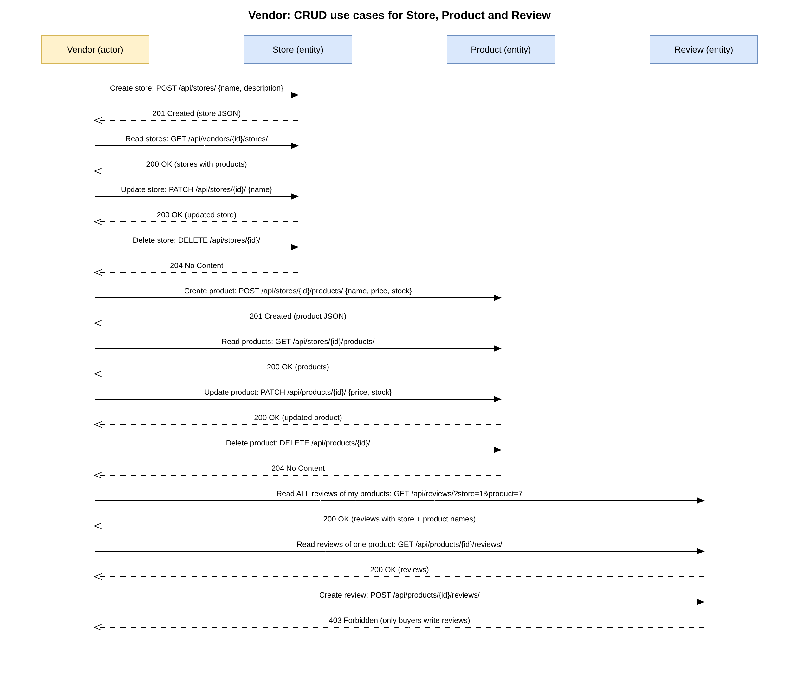
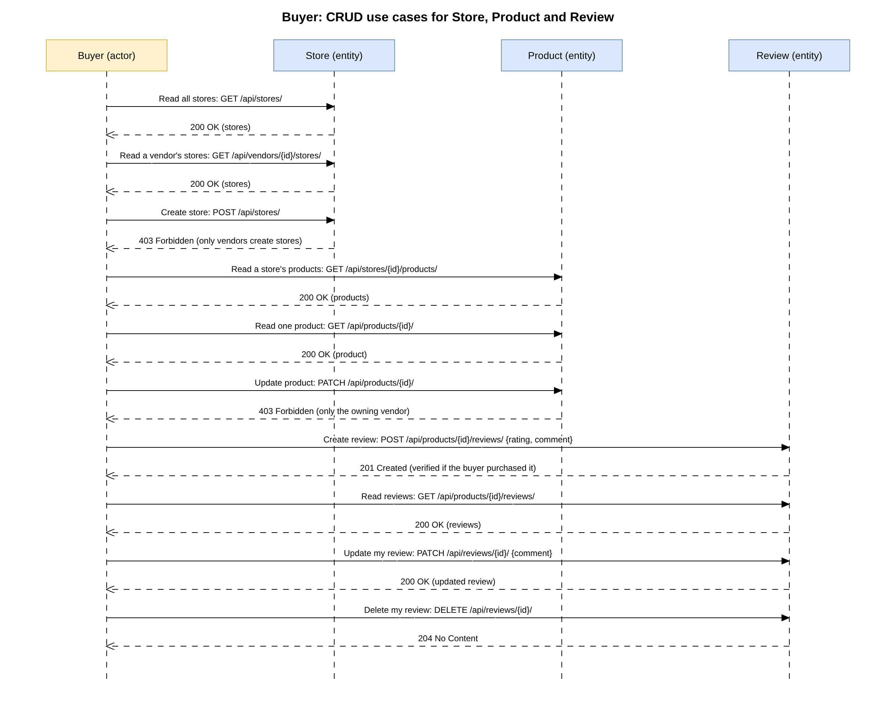

# 5. RESTful API Plan

## 1. Serialisation (models -> JSON)

Each model is exposed as a resource and serialised to JSON by a Django REST Framework serializer. JSON is used rather than XML because it is lighter and native to JavaScript clients (an XML renderer could be added later without changing the models).

**Store** (includes its products, read only)
```json
{ "id": 1, "vendor": 3, "vendor_name": "vendor1", "name": "Shop One", "description": "Gadgets",
  "created_at": "2026-10-12T18:00:00Z",
  "products": [ { "id": 7, "store": 1, "name": "Widget", "description": "", "price": "9.99", "stock": 5 } ] }
```
**Product**
```json
{ "id": 7, "store": 1, "name": "Widget", "description": "...", "price": "9.99", "stock": 5 }
```
**Review** (clients send only `rating` and `comment`)
```json
{ "id": 2, "product": 7, "product_name": "Widget", "store_name": "Shop One", "buyer_name": "buyer1",
  "rating": 5, "comment": "Great", "verified": true, "created_at": "2026-10-12T18:30:00Z" }
```
Server-controlled fields (`id`, `vendor`, `store`, `product`, `buyer`, `verified`, `created_at`) cannot be set by the client. Prices are strings to avoid float rounding. The review includes the store and product names so a vendor reading a combined list knows what each review is about.

## 2. Endpoints

Nouns not verbs, plural collection names, HTTP methods for the action, standard status codes.

| Method | URL | Who | Purpose |
|---|---|---|---|
| POST | `/api/auth/token/` | anyone | Exchange username + password for a token |
| GET | `/api/vendors/` | logged in | List vendors |
| GET | `/api/vendors/{id}/stores/` | logged in | Stores listed under one vendor |
| GET | `/api/stores/` | logged in | All stores (with products) |
| POST | `/api/stores/` | vendor | **Create** a store (owner = caller) |
| GET | `/api/stores/{id}/` | logged in | **Read** one store |
| PUT/PATCH | `/api/stores/{id}/` | owning vendor | **Update** a store |
| DELETE | `/api/stores/{id}/` | owning vendor | **Delete** a store |
| GET | `/api/stores/{id}/products/` | logged in | **Read** the products of a store |
| POST | `/api/stores/{id}/products/` | owning vendor | **Create** a product |
| GET | `/api/products/{id}/` | logged in | **Read** one product |
| PUT/PATCH | `/api/products/{id}/` | owning vendor | **Update** a product |
| DELETE | `/api/products/{id}/` | owning vendor | **Delete** a product |
| GET | `/api/reviews/?store=&product=` | logged in | **Read** reviews across products: a vendor gets reviews of all their products, a buyer gets their own |
| GET | `/api/products/{id}/reviews/` | logged in | **Read** the reviews of one product |
| POST | `/api/products/{id}/reviews/` | buyer | **Create** a review (many allowed per product) |
| GET | `/api/reviews/{id}/` | logged in | **Read** one review |
| PUT/PATCH | `/api/reviews/{id}/` | review's author | **Update** own review |
| DELETE | `/api/reviews/{id}/` | review's author | **Delete** own review |

Status codes: 200 OK, 201 Created, 204 No Content, 400 invalid data, 401 not authenticated, 403 wrong role / not the owner, 404 not found.

## 3. Authentication and authorisation
* Clients send `Authorization: Token <key>` on every request.
* No token -> 401. Wrong role -> 403 (e.g. a buyer creating a store, a vendor writing a review). Editing someone else's store/product/review -> 403.
* Ownership always comes from the token, never from the request body.

## 4. Sequence diagrams

The actors are separated: one diagram per actor, each showing the actor, the three entities (Store, Product, Review) and every Create / Read / Update / Delete use case, including the refused ones.

* `vendor_sequence_diagram.png` (editable: `vendor_sequence_diagram.drawio`)
* `buyer_sequence_diagram.png` (editable: `buyer_sequence_diagram.drawio`)



